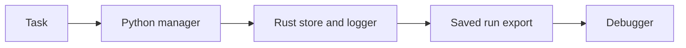

# Reckon Architecture

> **A laboratory for causal records under resource budgets**
>
> A Python memory manager over Rust storage, with separate experiment and debugger interfaces.

A task calls the Python manager to store or retrieve records and supplies the outcome. The manager chooses what to retain. The Rust extension stores and indexes records and buffers operation events; the manager retains native records with Python object adapters and separate fixed admission costs. To inspect a run, save an export and pass it to the debugger. These are separate places to look when a run fails to write, measure or display what you expected.

The [complete retrieval/outcome example](src/reckon/README.md#connect-retrieval-to-an-outcome) follows one stored cue through that Python boundary. The [product comparison](https://causality.in/reckon/compare-replay-budgets/) follows a task from paired inputs to saved results.

## Build Pipeline

Run `maturin build` to assemble the Python API and Rust extension into the `reckon` wheel. Protocol Buffers generate Python wire dataclasses with betterproto2 and Rust structs with prost and serde. The Rust laboratory model generates the current record TypeScript and JSON Schema. The root Buf configuration generates historical wire TypeScript with protobuf-ts; the [TypeScript SDK](sdks/typescript/README.md) uses its own Protobuf-ES and Connect generators.

The debugger builds separately. Run `pnpm build` in `viz-ui/` and copy `dist/` into `viz/static/` to ship the interface with the wheel. Follow the [server guide](src/reckon/viz/README.md#with-viz-ui) for that bundle. When changing the interface, run the Python backend and Vite separately.

## Component Responsibilities

### Rust Core (`kernel/`)

Python requires the Rust extension. Verify its import before debugging the application.

The kernel's default Rust build has no Python dependency. Its `python` feature enables PyO3; maturin selects `extension-module`, which enables that binding and its extension linking mode. The daemon and other Rust consumers use the default Rust API.

| Component | Responsibility | Data Structure |
| --- | --- | --- |
| `RecordStore` | Record storage, lookup, iteration | `hashbrown::HashMap<String, Record>` |
| `PriorityIndex` | Record priority from utility and beneficial measured effects | `BinaryHeap<RecordRef>` |
| `RetentionPolicy` | Rust-side retention policy implementations | Trait-based dispatch |
| `EventLogger` | High-frequency event buffering and explicit export | Ring buffer |

Use these numbers as performance targets when profiling:

- `select_for_pruning(10K records)`: < 1ms
- `write()`: < 100μs
- `read()`: < 50μs

### Python API (`src/reckon/`)

The Python CMM owns payload encoding for admission, budget-overflow calculation, policy selection and query filtering. [`kernel/src/record.rs`](kernel/src/record.rs) owns the laboratory record shape and generates its TypeScript and JSON Schema. PyO3 adapters retain the caller’s opaque payload, mutable lists and metadata; `memory/record.py` supplies Python behavior and dataclass compatibility around those native fields. Resource configuration remains in `core/resources.py`. The generated `betterproto2.Message` classes describe the separate historical wire contracts. Validation still depends on each operation; a generated type alone does not validate an incoming value.

The CMM delegates storage/index accounting, access touches, retention ranking and budget-prefix selection to Rust. Python policy objects choose the kernel rule and supply ranking inputs from the full records; the random arm supplies its existing seeded permutation. [Memory manager design](docs/08-Causal-Memory-Manager-Design.md) explains the enforced byte, slot, token and operation-rate limits, and the retrieval controls still to build.

The kernel priority index and daemon capacity pruning use one store-priority function, with harmful measured effects contributing no bonus and ties ordered by record ID. This store ranking remains a distinct rule from the per-byte laboratory choices and raw-score Rust policies. Those policies share kernel selection machinery without treating their different formulas as equivalent.

For integration, the manager accepts a `MemoryBudget`, a Python retention policy and an episode identity. Call `set_step()` with the task’s logical step before memory operations. The [retrieval/outcome example](src/reckon/README.md#connect-retrieval-to-an-outcome) defines the observation, matching query, context, supplied outcome and expected utility update. The context groups returned IDs for credit assignment; it is not the store’s episode reset. Credit weights and bounded utility updates are implemented once in `kernel/src/credit.rs`; Python calls them through PyO3 and the daemon calls them directly. Python and the daemon validate all proposed updates before applying an observation.

### TypeScript Debugger (`viz-ui/`)

pnpm monorepo with two packages:

| Package | npm | Purpose |
| --- | --- | --- |
| `packages/components` | `@rtepl/reckon-components` | Stateless visualization components |
| `packages/debugger` | `@rtepl/reckon-debugger` | Stateful app (Zustand + Tailwind) |

**Components** (stateless, reusable):

| Component | Library | Purpose |
| --- | --- | --- |
| Timeline | Custom Canvas | Memory event timeline; 100K+ events is a design target |
| CausalGraph | @xyflow/react | Directed graph of record inputs and supplied edge data |
| ParetoFrontier | plotly.js | Budget/performance tradeoffs |

**Debugger** (stateful app):

- Zustand store with RAF-batched WebSocket updates
- Feature-sliced architecture (`features/timeline`, `features/causal-graph`, etc.)
- Serves a separately built interface when its files have been copied into the Python package’s static directory; installing the Python extra alone does not compile that interface.

### Protocol Buffers (`protos/`)

Edit the protocol declarations when changing a wire message. Check the explicit adapters to the Rust laboratory model and the debugger view for fields that need conversion. Preserve the fields their consumers rely on.

> **Source Files** (authoritative - do not duplicate here):
>
> - [`protos/reckon/record.proto`](protos/reckon/record.proto) - MemoryRecord, PayloadType, RecordCost
> - [`protos/reckon/budget.proto`](protos/reckon/budget.proto) - ResourceVector, MemoryBudget, RetentionPolicyType
> - [`protos/reckon/causality.proto`](protos/reckon/causality.proto) - CausalRelation, DirectInfluenceRecords
> - [`protos/reckon/events.proto`](protos/reckon/events.proto) - MemoryEvent, DebuggerEvent

## Data Flow



### Write Path

Python admits the write through its operation-rate limit, refuses a record that exceeds its byte or token allowance, and calculates byte, slot and token overflow together. The configured policy supplies a removal set sufficient for all three. The manager validates that set before pruning: duplicate or absent IDs and insufficient freed capacity are errors. The [memory manager's budget contract](docs/08-Causal-Memory-Manager-Design.md#memorybudget) defines token counts and operation windows. Python computes a provenance hash when it constructs the record, but repeated writes still create records; deduplication remains design work.

Rust retains the native Python-facing record and a fixed admission projection for accounting and the priority index. The manager logs each removal with `EventLogger.log_prune()` and the write with `EventLogger.log_write()`, then returns the record ID.

The same selected policy controls byte, slot and token pressure; the manager does not substitute a utility ranking to finish the removal set. The Rust store’s separate priority index does not choose these Python-manager removals.

### Read Path

Python admits the read through its independent operation-rate limit, then looks up the explicit IDs or filters the live native records. It ranks query results by utility, applies the limit, updates access statistics with `RecordStore.touch_object()`, logs the reads with `EventLogger.log_read()` and returns the records.

Query predicates are `tags`, `payload_type` and `min_utility`; similarity search and need-triggered retrieval remain part of the intended model. `retrieve()` uses this read path and adds credit-assignment tracking.

The [record evaluator](src/reckon/metrics/evaluator.py) installs a scoped intervention after candidate selection and before access. It removes the chosen record, resolves the query again and checks matching paired state at that boundary. The returned records alone enter access logs and credit tracking.

### Visualization Path

Save `events.jsonl` and run `reckon viz import`. The browser loads existing events with `GET /v1/runs/{id}/events` or streams them with `/v1/stream?run_id=...`. `POST /v1/runs/{id}/events` appends events and broadcasts them to subscribers.

The logger buffers events in memory. The caller must save them to produce a JSONL file. There is no automatic flush every 100ms. `get_event_log()` drains the buffer, while `get_event_log_jsonl()` returns its current rows as a string. The [visualization module](src/reckon/viz/README.md) describes imported runs and the separately registered live-CMM path.

## Configuration

> **Source Files** (authoritative - do not duplicate here):
>
> - [`pyproject.toml`](pyproject.toml) - Python package configuration + Maturin build settings
> - [`kernel/Cargo.toml`](kernel/Cargo.toml) - Rust crate configuration

## Testing Strategy

| Layer      | Framework           | Focus                                  |
| ---------- | ------------------- | -------------------------------------- |
| Rust       | `cargo test`        | Store, logging and kernel behavior     |
| Python     | pytest + Hypothesis | API tests, integration, property-based |
| TypeScript | Vitest              | Components and utility functions       |

### Key Invariants (Property Tests)

- Storage budget invariant: successful writes remain within configured byte, slot and token limits. An oversized record is refused before existing records change.
- Pruning invariant: the selected policy supplies sufficient distinct existing records before removal begins. Operation limits admit reads and writes separately, as described in the [memory manager design](docs/08-Causal-Memory-Manager-Design.md#memorybudget).
- Transitivity violations in the influence relation are detected and reported, never assumed away (influence is not transitive in general)
- Keep logical steps in order when writing task code. With operation limits enabled, `set_step()` refuses a lower step; without those limits, it accepts one and does not correct the event order.

## Local builds

**Target**: Local/laptop only (no cloud infrastructure)

```bash
# Development
pip install -e ".[dev,viz]"
maturin develop

# Build wheels in an explicit output directory
maturin build --release --out dist
```

Install the exact `reckon-*.whl` produced for your Python interpreter and platform with `python -m pip install <wheel-path>`. Use a new or empty output directory to keep an older wheel from being mistaken for the new build. A release-mode wheel is a build artifact, not a public release or a remotely deployable service.

## Documentation Map

- [Python integration](src/reckon/README.md#connect-retrieval-to-an-outcome): connect a returned record to one supplied outcome and understand the context lifetime.
- [Memory manager](src/reckon/memory/README.md): current records, policies, budget handling and mutable access.
- [Tasks](src/reckon/tasks/README.md): implement a benchmark through `BaseTask` and interpret its own result producer.
- [Metrics](src/reckon/metrics/README.md): distinguish usage helpers, actual intervention comparisons and cost accounting.
- [Visualization server](src/reckon/viz/README.md): preserve an export, index its metadata and supply event bytes to the browser.
- [Debugger components](viz-ui/packages/components/README.md): embed a timeline, evidence graph or plot with the required inputs.
- [Reproducibility](docs/12-Reproducibility.md): retain configuration, source, dependencies, results and event ordering for a repeatable comparison.

## Future Considerations

The gRPC daemon owns a separate in-memory store. Its context store serializes retrieval admission and attribution updates, refuses new contexts when its independent count limit is full, and reclaims expired contexts on retrieval and on a server-lifetime timer. A live context keeps its original episode and expiry; observation takes an attribution snapshot before expiry. See the [repository overview](README.md#the-grpc-daemon-is-a-local-tool) for its loopback-only bind and refused probes. [Run export](daemon/README.md) retains operation-bound snapshots separately from the live store and refuses unsupported attachments. Sharing Rust storage with the browser through WASM and adding distributed tracing remain possible extensions. Remote deployment would also require authentication, transport protection and state recovery.

:::accordion "Design choices and source map"

## Design Decisions

| Decision | Choice | Rationale |
| --- | --- | --- |
| **Schema Source** | Rust laboratory model and separate historical protobuf contracts | Rust owns the current laboratory record and generates TypeScript and JSON Schema; protobuf declarations retain their historical wire meanings |
| **Performance Core** | Rust (PyO3 + maturin) | Required storage/index extension; performance targets are listed below |
| **Python API** | PyO3 record adapters and Python resource configuration | Mutable records follow the Rust laboratory model; generated betterproto2 dataclasses provide separate historical wire models |
| **Visualization** | React + Vite + Canvas + React Flow | Interactive event timeline, record graph and budget comparisons |
| **Math Documentation** | Markdown with fenced `math` blocks | Keep equations readable in the source manual |
| **Testing** | Hypothesis + pytest | Property-based testing for invariants |
| **Repository** | Monorepo | Single version control, atomic commits across languages |

## Directory Structure

The implementation separates the things an experiment changes from the things that store or display its observations:

| Location | Responsibility |
| --- | --- |
| `src/reckon/memory/` | Full Python records, query filtering and retention-policy selection |
| `kernel/` | Record storage, priority indexing and a fixed-capacity event logger, exposed through PyO3 |
| `src/reckon/tasks/` | Task data, agent or learner behavior, episode schedule and task-specific results |
| `src/reckon/metrics/` | Optional analysis helpers, intervention runners and cost accounting |
| `protos/` | Language-neutral wire declarations and their generation configuration |
| `src/reckon/viz/` | Imported-run storage, REST retrieval and WebSocket delivery |
| `viz-ui/` | Browser components and the stateful debugger application |
| `daemon/` | A separate Rust gRPC service with its own in-memory store |
| `notebooks/` | Exploratory notebooks and explicit artifact-saving helpers |

The [laboratory model and conversions](kernel/README.md#complete-laboratory-records) keep opaque Python objects in live native records and exchange explicitly encoded bytes in snapshots. New JSON snapshots preserve unknown token counts as null and int64 values as decimal strings. The historical scalar wire keeps its numeric meaning and refuses an unknown count on export. The daemon stores the generated `core.v1.Record` directly, preserving its typed tags and links through queries and named-run export; [daemon record helpers](daemon/src/record.rs) initialize and score it without duplicating its fields. Those tags and links remain distinct from laboratory tags and origin. Losing a field or its absence during any translation changes which questions a later view can answer.

:::
