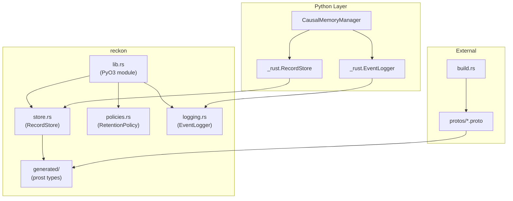

# Reckon Rust Core

> The Rust kernel of Reckon's laboratory: its record store, credit updates and event log.

## Purpose

This crate provides the performance-critical components of Reckon. Rust consumers build it without Python by default. The `python` feature enables its PyO3 bindings, and `extension-module` also selects the linking mode used by the Python package. Maturin selects that feature through the root `pyproject.toml`. Python accesses the kernel through `reckon._rust`; the extension remains required and there is no pure Python fallback.

## Components

### Credit and utility (`credit.rs`)

Python and the gRPC daemon call one implementation of equal, shaped and ablation-based credit, followed by the bounded moving-average update. SHAPED uses stable softplus at an explicit positive scale; the laboratory default is 1.0. ABLATION normalizes positive measured deltas, returns zero weights when measurements exist but none is positive, and uses equal credit only when all measurements are absent. Neither call changes the stored measurements. Invalid input fails before callers apply the observation's updates. See the [Python core guide](../src/reckon/core/README.md#credit-assignment-in-python) for defaults and input domains.

### RecordStore (`store.rs`)

Thread-safe record storage with priority indexing.

The kernel index and daemon capacity pruning share `retention_priority`: utility plus half the positive parts of the ablation and counterfactual measurements. Missing or NaN measurements add no bonus; a NaN total sorts first for removal. Both break equal scores by record ID. Proxy magnitude and cost do not enter this store ranking.

| Component | Data Structure | Purpose |
| --- | --- | --- |
| `records` | `hashbrown::HashMap` | O(1) record lookup |
| `priority_index` | `BinaryHeap` | O(log n) pruning selection |
| `current_bytes`, `current_tokens` | `parking_lot::RwLock<i64>` | Track declared byte and token totals |

Key operations:

- `insert()`: Add record, update index
- `get()`: O(1) lookup by ID
- `remove()`: Delete record, update usage
- `select_for_pruning()`: Return lowest-priority records
- `touch()`: Update access stats
- `fork()`: Copy complete records, priorities and accounting for an independent in-memory trial

`fork()` holds the record lock while copying the other store components in their declared lock order. The copy keeps the slot capacity and every native admission field. Its Python binding also deep-copies the live record objects, preserving shared references within the copy and separating mutations from the original. The manager starts a fresh trial log and operation windows. This is an in-memory operation, not persistence or a replay format.

`insert()` returns `Result<Option<Record>, RecordStoreError>`. A successful replacement returns the old record; a new ID returns `None` inside `Ok`. Negative byte or token costs and either total above the signed 64-bit range are refused before records, priorities or accounting change. The final-total check deducts a replacement's old cost and runs under the store's mutation lock. Native zero-byte records remain valid. The caller enforces its byte, slot and token budgets and chooses any removals; `capacity()` reports the declared slot capacity.

`touch()` returns `Result<bool, RecordStoreError>`: `Ok(true)` when updated and `Ok(false)` for a missing ID. At the signed 32-bit access-count maximum, it returns `UseCountOverflow` before changing either the count or last-access timestamp. Python receives `OverflowError`; ordinary calls still return a Boolean.

### Complete laboratory records

[`record.rs`](src/record.rs) owns the laboratory record, cost, origin, utility, score and payload-kind model. The PyO3 adapters use the same generic record structure with Python references for opaque payloads and mutable containers. The manager calls `prepare_object()` before choosing budget removals, then retains the native object and its validated admission projection with `insert_object()`. That projection retains the original costs even when a caller edits returned metadata. The Python facade preserves dataclass helpers, copying, pickling and cyclic references, and the bindings participate in Python garbage collection.

The default exchange representation carries explicitly encoded payload and metadata bytes. `MemoryRecord.snapshot_json(payload_bytes, metadata_bytes)` leaves the live objects intact, represents int64 fields as decimal strings and keeps unknown tokens as null. Byte/step/token values use signed 64-bit storage; slot/access counts use signed 32-bit storage. JSON export refuses non-finite utility or score values. `snapshot_wire()` uses the historical laboratory protobuf format and refuses an unknown token count, since its scalar field cannot express one.

`Record::try_from(proto::MemoryRecord)` and the reverse conversion preserve every declared laboratory field through storage, copying and removal: opaque payload and metadata bytes, compression labels, ordered tags, supplied origin, utility and score fields, and optional creation positions. The conversion requires cost, utility and causal-score messages and refuses unknown payload kinds. It preserves absent origin and optional measurements, including the difference between absent and measured zero. Signed 64-bit values remain exact. The laboratory schema's token count is a scalar, so its wire value does not distinguish unknown from zero.

Low-level callers can still use `Record.from_wire(data)`, `store.insert_record(record)` and `record.to_wire()` with generated historical laboratory messages. This byte route does not serialize arbitrary Python objects. Both `insert()` and `insert_record()` refuse an ID already backed by a live object with `ValueError`, before changing either view or its accounting. Remove that entry explicitly before changing its representation. The scalar token value always remains numeric, including zero. The daemon's `core.v1.Record`, with typed tags and links, remains a separate contract. Protobuf unknown fields are not retained by the native decoder.

From `viz-ui/`, run `pnpm generate:records` to emit the Rust-derived TypeScript and JSON Schema; component builds run this step automatically. The outputs under `packages/components/src/generated/` and `kernel/generated/` are excluded build artifacts. `node scripts/generate-records.mjs --check` compares them with the current model. Python can obtain the same schema from `reckon._rust.record_schema()`. The descriptions do not replace validation: the browser adapter refuses int64 values outside JavaScript's exact integer range.

### PriorityIndex

The heap uses lazy deletion. `insert(id, priority)` pushes a `RecordRef`. `update(id, new_priority)` marks the previous entry invalid and pushes the new one. `pop_lowest()` skips invalid entries. Call `rebuild()` to reconstruct the heap.

### EventLogger (`logging.rs`)

High-frequency event ring buffer:

| Component    | Purpose                        |
| ------------ | ------------------------------ |
| `buffer`     | `VecDeque` with fixed capacity |
| `counter`    | Atomic event ID generator      |
| `episode_id` | Current episode context        |

Operations:

- `log()` / `log_full()`: Add event to buffer
- `drain()`: Return and clear all events
- `since(event_id)`: Get events after ID
- `to_jsonl()`: Export as JSON Lines

### Retention Policies (`policies.rs`)

The Rust policy trait and Python laboratory wrappers call `select_retention`, which returns the shortest ranked prefix meeting byte, record-slot and token pressure. The Rust trait returns a `Result`; invalid costs, repeated IDs, non-finite selected scores and invalid weights are errors. A request exceeding the whole input returns every record, leaving its caller to refuse infeasible admission before mutation. Equal ranking keys preserve input order. Token costs use the existing `Record.cost_tokens` field and a separate stopping threshold; token pressure does not alter the ranking or its byte denominator. `select_retention` and `select_for_budget` take token pressure after slot pressure, and the byte-only `select_for_pruning` trait method supplies zero for the other dimensions.

| Policy | Selection Criterion |
| --- | --- |
| `FifoPolicy` | Oldest first (by timestamp) |
| `LruPolicy` | Least recently used |
| `UtilityPolicy` | Lowest raw utility first |
| `WeightedEvidencePolicy` | Lowest weighted combination of utility, measured effects and proxy magnitude |
| `DiversityPolicy` | Lowest raw utility in a round-robin traversal of payload types |

The kernel keeps different rankings explicit. Python's `UtilityPolicy` chooses `UtilityPerByte`, while the Rust `UtilityPolicy` chooses `RawUtility`. Python LRU orders equal access times by creation time; the Rust LRU wrapper preserves input order for those ties. Python's `EvidencePerBytePolicy` chooses `EvidencePerByte`; Rust's `WeightedEvidencePolicy` chooses `WeightedEvidence`. See the [policy distinction](../docs/03-Math-Core.md#6-5-optimal-pruning) before comparing results. Python's importance arm supplies its declared importance as the per-byte score, and its random arm supplies the existing seeded order; both use the same prefix-selection rule.

`WeightedEvidencePolicy::new(evidence_weight)` mixes utility with the weighted signals using a weight clamped to [0, 1]; NaN is refused at selection. Its name is `WeightedEvidence` and its log reason is `weighted_evidence_lowest`. Earlier saved records retain their original policy name and source revision.

Diversity groups payload types in lexical order, removes their low-utility surplus round-robin, then continues below the requested per-type minimum when capacity requires it. The minimum is a preference, not a guarantee that can defeat the budget. The Python comparison runner exposes this same rule as `diversity`.

Measured ablation and counterfactual deltas retain their signs in records. `WeightedEvidencePolicy` and the store’s priority index give a harmful effect zero retention bonus; utility remains separate. The policy’s proxy component keeps its magnitude-based meaning. This sign rule does not make the Python policy, Rust policy and store priority the same ranking; their separate formulas remain on the [policy score page](../docs/03-Math-Core.md#policy-score-for-retention).

## PyO3 Integration

### Exposed Types

| Rust Type           | Python Name       | Purpose          |
| ------------------- | ----------------- | ---------------- |
| `PyRecordStore`     | `RecordStore`     | Record storage   |
| `PyRecord`          | `Record`          | Single record    |
| `PyEventLogger`     | `EventLogger`     | Event logging    |
| `PyRetentionPolicy` | `RetentionPolicy` | Policy selection |

### Python Usage

```python
from reckon._rust import RecordStore, EventLogger

store = RecordStore(max_slots=10000)
logger = EventLogger(capacity=10000)
```

Type stubs in `src/reckon/_rust.pyi` provide IDE support.

## Performance Characteristics

### Target Metrics

| Operation                 | Target  | Mechanism                      |
| ------------------------- | ------- | ------------------------------ |
| `write()`                 | < 100us | Via HashMap insert + heap push |
| `read()`                  | < 50us  | Via HashMap lookup             |
| `select_for_pruning(10K)` | < 1ms   | Via BinaryHeap                 |

The timings are design targets. The listed data structures explain the implementation; they do not establish measured latency or attainment of those targets.

### Measure the native store

Run `cargo bench --manifest-path kernel/Cargo.toml --bench store_bench -- --noplot` from the repository root. The benchmark measures three batches: inserting 1,000 prepared 100-byte records, reading 100 evenly spaced keys from 1,000 records, and selecting 100 records from a 10,000-record store. Selection identifies records totaling 10,000 bytes and leaves them stored. The read keys are fixed, not random.

Fixture construction is outside the timed operations. Insertion also excludes destruction of the resulting store; reads include cloning and dropping each returned record, and selection includes restoring the index and dropping the returned IDs. Criterion uses 30 samples with a one-second warmup and three-second measurement window per case. Its estimates and raw samples go under `kernel/target/criterion/`. Batch timings and per-record throughput are different quantities; neither establishes the Python API's latency or a memory-policy benefit.

The [15 November 2026 measurement](benches/results/2026-11-15-macos-arm64.json) retains the raw samples, estimates, source hashes and toolchain. It predates the direct-insert cost and overflow checks. On an Apple M4 Max with macOS ARM64 and Rust 1.94.0, while other development work was active, the estimated batch times were:

| Batch                        | Estimate  | 95% confidence interval |
| ---------------------------- | --------- | ----------------------- |
| Insert 1,000 records         | 433.52 µs | 345.83–521.70 µs        |
| Read 100 keys                | 32.92 µs  | 28.38–39.07 µs          |
| Select 100 of 10,000 records | 34.32 µs  | 28.31–41.82 µs          |

These are observations from one shared development host and one workload, not a latency guarantee. Re-run the command on the intended deployment workload before comparing it with the targets above.

### Memory Layout

- Records stored by value in HashMap
- PriorityIndex stores lightweight `RecordRef` (ID + priority)
- Lazy deletion avoids heap rebuild on updates

### Future storage and performance choices

The current kernel keeps records and events in memory. The following choices are conditional design work; the [native store measurements](#measure-the-native-store) provide a baseline for deciding what needs to change.

**Batch statistics.** Consider `faer` for the probe's numerical batches only when profiling a measured experiment identifies those calculations as a material cost. Measure that cost separately from running the paired task episodes, copying memory and collecting results. A faster calculation must preserve the experiment's estimates and uncertainty; the [reproducibility guide](../docs/12-Reproducibility.md#measure-retained-records-before-pruning) defines the comparison it serves. `faer` is not a current dependency.

**Graph dependencies.** The kernel has no runtime use of `petgraph` and no MONAD source dependency. The resolved build still includes `petgraph` through `prost-build`, the protocol compiler listed in [Cargo.toml](Cargo.toml). That build dependency supplies no graph capability to Reckon's record store. Add a runtime graph representation only for an identified operation and its data requirements.

**Durable records and replay.** A future laboratory store must define what survives a restart and retain enough record state and ordered operations to reconstruct the run it promises to replay. The current event ring can overwrite entries and omits full record state; `RecordStore.fork()` makes an independent in-memory trial. The debugger's [RunStore](../src/reckon/viz/README.md) saves supplied event files and summaries for viewing. Those exports remain useful, but recovering the live manager requires a separate persistence and replay contract, including how an interrupted write is handled.

**Arena allocation.** Consider a generational slot arena only if measurements of the intended workload identify the map and heap as the store's bottleneck. The existing batch timings alone do not establish that cause. Share reusable arena and ring mechanics through `rtepl-common` when that work is justified. Reckon keeps the meaning of its records, budgets and retention policies; Pale keeps the meaning of its own graph and scheduling state. Shared storage mechanics must preserve those separate contracts.

**Linux I/O.** Consider an `io_uring` adapter only after a durable store and a Linux deployment exist. The adapter owns its pinned I/O buffers; the record arena has a separate lifetime. Its portable fallback must produce identical stored and replayed results for the same operations. Establish the store's correctness and recovery behavior before comparing I/O throughput.

## Building

Follow [installation](../docs/01a-Installation.md#set-up-the-environment) for a new CPython 3.11 environment. The documented CPython range is 3.9–3.12. Pass the interpreter explicitly so the build and import check use the same environment. Run the commands below from the Reckon repository root.

### Protocol Buffers compiler

The kernel and daemon build scripts use `protoc-bin-vendored = 3.3.0`, which supplies `protoc` 36.2 for the build host. Cargo fetches those packages with the other build dependencies; installing a system compiler is optional. Rust consumers such as HENA and Q-HENA inherit this build requirement through the kernel. An offline build needs the packaged compiler in Cargo's cache.

Set `PROTOC` to an executable path to select a compiler explicitly. `PROTOC_INCLUDE` can select its include directory. When choosing the packaged compiler, the build also uses its packaged includes unless `PROTOC_INCLUDE` is already set. Cargo reruns generation when either selection changes. Generated Rust stays in Cargo's build output directory.

### Development

```bash
(cd kernel && cargo build)
```

This builds the Rust API without PyO3. The daemon and Rust re-export consumers use that default. The kernel has no sibling source dependency. MONAD remains the manual’s source of formal definitions; no implemented kernel path uses its types. Use `cargo check --features python` in `kernel/` when checking the binding without extension-module linking.

Run `cargo test --manifest-path kernel/Cargo.toml --test store_properties` for the exhaustive small-state checks. They compare 32,768 length-five operation traces with an independent map, checking replacement, removal, utility/access updates, pruning, rebuilding, accounting and repeatable priority selection. A second property checks all 341 cost vectors of up to four records over zero, small and large costs, across 13 policy configurations and feasible or infeasible byte/slot pressures. These tests cover valid input domains; `RecordStore` leaves admission limits to its caller.

### Python Extension

```bash
# With the supported project environment active, from the repository root
maturin build --interpreter "$VIRTUAL_ENV/bin/python" --out "$VIRTUAL_ENV/wheels"
python -m pip install --force-reinstall --no-deps "$VIRTUAL_ENV"/wheels/*.whl
python -c "from reckon._rust import EventLogger, RecordStore"
```

The installation guide installs the runtime dependencies before this rebuild. `--force-reinstall --no-deps` replaces the installed package with the new wheel while keeping those dependencies. `cargo build` alone does not refresh the Python extension. For editable Python development, `maturin develop` uses the active supported environment and writes its extension into the source package; do not use that route when preserving an existing source-tree extension.

### Release

```bash
# From the repository root with the project environment active
maturin build --release --interpreter "$VIRTUAL_ENV/bin/python"
```

## Proto Integration

Types are generated from Protocol Buffers via prost:

```rust
// build.rs
prost_build::compile_protos(&["../protos/reckon/record.proto"], &["../protos"])?;

// lib.rs
pub mod proto {
    include!(concat!(env!("OUT_DIR"), "/reckon.rs"));
}
```

## Lock Ordering

To prevent deadlocks in `RecordStore`, always acquire locks in this order:

1. `records` (RwLock)
2. `priority_index` (RwLock)
3. `current_bytes` (RwLock)
4. `current_tokens` (RwLock)

Never hold `priority_index` while acquiring `records`.

## Error Handling

The crate uses `thiserror` for error definitions. Common error patterns:

- Record not found: Returns `Option<Record>` (None if missing)
- Insert with duplicate ID: Returns `Ok(Some(record))` containing the replaced record
- Negative byte or token cost, or either overflowing total: Returns `RecordStoreError` without mutation; Python receives `ValueError` or `OverflowError`, respectively
- Buffer overflow: Events are dropped (check `dropped_count()`)

## Tracing Instrumentation

Key operations are instrumented with `tracing`:

```rust
use tracing::{instrument, debug};

#[instrument(skip(self))]
pub fn insert(&self, record: Record) -> Option<Record> {
    debug!(id = %record.id, "inserting record");
    // ...
}
```

Enable tracing by configuring a subscriber in your Python code or Rust tests.

:::accordion "Source map and dependencies"

## Architecture



## Module Structure

Start in `store.rs` to trace a lookup or change index maintenance, `logging.rs` for buffer behavior, and `policies.rs` for the Rust-side rankings.

:::

<a id="maintenance-gotchas"></a>

## Troubleshooting

1. **Python version**: PyO3 0.20.3 builds an `abi3-py39` wheel. If the extension will not import, activate the documented environment, pass its interpreter to the build and verify that you installed the resulting wheel into that same environment.

2. **Non-Local Definitions Warning**: PyO3 generates code with non-local impl warnings. Suppressed with `#![allow(non_local_definitions)]`.

3. **Thread Safety**: The store and logger protect shared state with `parking_lot` locks and atomic counters. Follow the store’s lock ordering above; a cloned `Record` is a value, not another synchronized store.

4. **Lazy Deletion Overhead**: PriorityIndex accumulates invalidated entries. Call `rebuild()` periodically for long-running processes.

5. **Event Buffer Overflow**: Ring buffer overwrites oldest events. Monitor `dropped_count()` to detect overflow. Ensure capacity matches expected event rate.

6. **Prost Regeneration**: `build.rs` declares each selected schema with `cargo:rerun-if-changed`. Cargo reruns that build step when those inputs change. Rebuild the extension with maturin to make the regenerated types available to Python.

7. **NaN Handling**: `priority_score()` returns `NEG_INFINITY` for NaN scores, ensuring such records are pruned first.

## Testing

```bash
# From the repository root
(cd kernel && cargo test)
```

Key tests:

- `test_priority_index`: Heap ordering correctness
- `test_record_store_insert_get`: Basic CRUD
- `test_select_for_pruning`: Priority-based selection
- `test_ring_buffer_overflow`: Buffer wrap behavior

<a id="further-reading"></a>

## Related guides

- [Architecture Overview](../ARCHITECTURE.md)
- [Python Memory Module](../src/reckon/memory/README.md)
- Protocol definitions: [records](../protos/reckon/record.proto), [budgets](../protos/reckon/budget.proto), [influence relations](../protos/reckon/causality.proto) and [events](../protos/reckon/events.proto).
