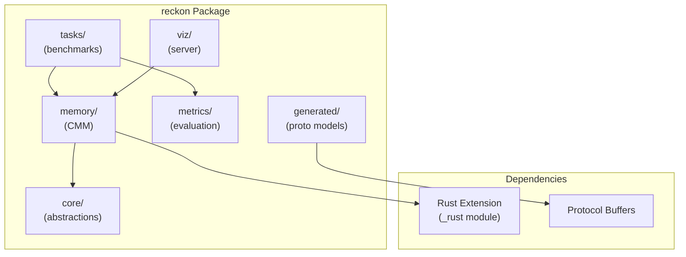

# Reckon Python Package

The `reckon` package connects a task's observations and outcomes to a budgeted record store. Python owns full records, queries and retention decisions; the required Rust extension owns compact storage, indexing and the event buffer. Start with [the retrieval/outcome example](reckon/README.md#connect-retrieval-to-an-outcome) to wire the API into a decision, or jump to the [module overview](#module-overview) to find the code responsible for a behavior.

## Package Structure

The command-line runner (`reckon/cli.py`) dispatches tasks. The extension stubs (`reckon/_rust.pyi`) describe the types Python can import. [Examples](examples/README.md) and [tests](tests/README.md) show how to run and check an integration.

## Architecture

## Module Overview

| Module | Purpose | Key Classes |
| --- | --- | --- |
| [`core/`](reckon/core/README.md) | Mathematical abstractions | `ResourceVector`, `MemoryBudget`, `DirectInfluenceRecords` |
| [`memory/`](reckon/memory/README.md) | Memory management | `CausalMemoryManager`, `MemoryRecord`, `RetentionPolicy` |
| [`tasks/`](reckon/tasks/README.md) | Benchmark tasks | `BaseTask`, `KeyDoorTask`, `BanditTask` |
| [`metrics/`](reckon/metrics/README.md) | Evaluation | `PerformanceMetrics`, `MemoryEfficiencyMetrics`, `RecordSummaryMetrics` |
| [`viz/`](reckon/viz/README.md) | Debugger server | FastAPI application, WebSocket routes |
| `generated/` | Proto-generated wire models | betterproto2 dataclasses from `.proto` files |

## Integration Points

### Rust Extension

The `reckon._rust` module provides high-performance implementations:

- `RecordStore`: O(1) lookup, O(log n) pruning
- `EventLogger`: Ring buffer for memory events

Type stubs in `_rust.pyi` enable IDE support.

### Protocol Buffers

Generated `betterproto2.Message` dataclasses in `generated/` come from the protocol sources for [records](../protos/reckon/record.proto), [budgets](../protos/reckon/budget.proto), [influence relations](../protos/reckon/causality.proto) and [events](../protos/reckon/events.proto). These are wire models. The public memory and resource API uses handwritten dataclasses in [record.py](reckon/memory/record.py) and [resources.py](reckon/core/resources.py). Regenerating bindings does not change those public classes or give them automatic Pydantic validation or JSON Schema export; their implemented checks determine validation.

## Troubleshooting

1. **Rust Extension Required**: The package will not function without the compiled Rust extension. Rebuild after Rust changes using the [kernel procedure](../kernel/README.md#python-extension).

2. **Proto Regeneration**: After modifying `.proto` files, regenerate wire models with `python protos/generate_python.py` using the [optional Python 3.10+ protocol tools](../protos/README.md). Review any corresponding handwritten public types and conversions separately.

3. **Type Stubs**: Keep `_rust.pyi` synchronized with Rust exports when adding new Python-visible functions.

4. **Circular Imports**: The `TYPE_CHECKING` guard is used throughout to avoid circular import issues between modules.

## Related guides

- [Main Module Guide](reckon/README.md) - Detailed module documentation
- [Architecture Overview](../ARCHITECTURE.md) - System design and data flows
- [Examples](examples/README.md) - Usage examples
- [Tests](tests/README.md) - Test organization
