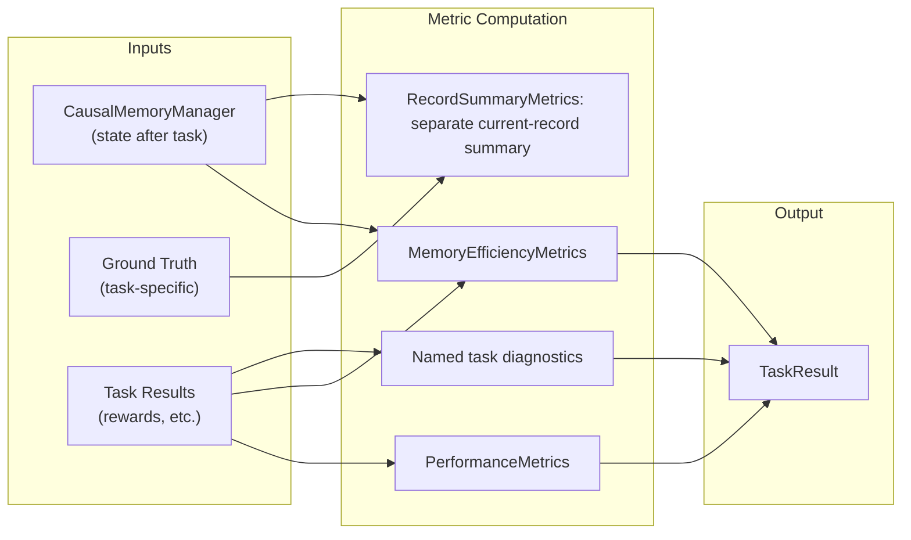

# Reckon Metrics Module

Use these helpers to summarize outcomes, memory costs and the results of record tests. Start with the function that produces your number. Current tasks expose their specific summaries through `TaskResult.diagnostics`; historical runs retain their original field names. Record summaries name access, caller-labelled retention and stored scores separately; none is an intervention test.

For the intervention design, method limits and cost-accounting example, use [Evaluation metrics](../../../docs/11-Evaluation-Metrics.md). For a complete task comparison with saved outputs, use [Compare two replay budgets](https://causality.in/reckon/compare-replay-budgets/).

## Components

### PerformanceMetrics

The current [`PerformanceMetrics`](performance.py) fields are:

| Metric | Description |
| --- | --- |
| `success_rate` | Fraction of episodes achieving goal |
| `mean_return` | Average cumulative reward |
| `mean_regret` | Mean supplied regret |
| `mean_accuracy` | Mean supplied classification accuracy |
| `backward_transfer` | Optional field supplied directly by a producer; `from_episodes()` does not compute it |
| `forgetting` | Mean supplied forgetting value |

`from_episodes()` averages available fields; it does not reconstruct task histories or invent missing measurements. An empty input produces an empty metrics object. Task runners may construct the fields directly with their own definitions, as described in [Tasks and Benchmarks](../../../docs/09-Tasks-Benchmarks.md).

### MemoryEfficiencyMetrics

[`MemoryEfficiencyMetrics.from_cmm()`](memory.py) uses the following quantities:

| Metric | Description |
| --- | --- |
| `total_reward_per_byte` / `mean_return_per_byte` | Supplied total reward or mean return, identified by its key, divided by peak recognized write-event bytes; otherwise current stored bytes |
| `total_reward_per_slot` / `mean_return_per_slot` | The corresponding supplied numerator divided by current occupied slots |
| `reads_per_write` | Recognized read-event count divided by write-event count, with supplied `total_reads`/`total_writes` fallbacks; this can exceed one |
| `useful_reads_per_read` | Supplied `useful_reads` divided by the selected read count; it is not a fraction of distinct stored records |
| `peak_usage_bytes` | Maximum `bytes_after` among recognized write events; current usage when none are recognized |
| `average_usage_bytes` | Mean `bytes_after` among recognized write events, or `None` when none are recognized; not a time-weighted memory average |

The helper calls `cmm.get_event_log()`, which drains the native buffer. Preserve required events before that consumption. When `total_reward` is supplied, only the total-reward keys are emitted, including an observed zero. Otherwise supplied `mean_return` uses its own keys. Missing both inputs leaves all reward ratios absent. Total reward and mean return are not interchangeable.

The helper reads `op_type` and `bytes_after` directly from the [native logger’s Python drain](../../../kernel/src/logging.rs). The manager supplies total stored bytes after each write. Retained write samples determine the peak and mean; when there are no write samples, current usage supplies only the peak. Supplied task counts remain fallbacks when the retained buffer has no events of that kind. Keep the buffer’s coverage with the result: draining it early or exceeding its capacity can leave only part of a run.

### RecordSummaryMetrics

[`RecordSummaryMetrics.from_cmm()`](record_summary.py) computes usage/oracle quantities from current records and supplied labels or scores:

| Metric | Description |
| --- | --- |
| `used_record_fraction` | Currently stored records with `utility.use_count > 0`, divided by stored records; a usage proxy requiring no ground truth or ablation |
| `necessary_cue_retention` | Retained IDs from `necessary_cues`, divided by positive `total_cues` (defaulting to the number of necessary IDs) |
| `useful_retrieval_fraction` | Supplied useful retrievals divided by retrievals, only when the necessary-cue denominator is not positive |
| `max_abs_stored_ablation_delta` | Largest absolute finite stored `ablation_delta` |
| `mean_stored_ablation_delta` | Signed mean of finite stored `ablation_delta` values |
| `proxy_only_record_ids`, `proxy_only_record_count` | Sorted IDs and count of current records with a proxy but neither delta; see [field-presence rules](../../../docs/11-Evaluation-Metrics.md#distinguish-proxy-only-records) |

The helper does not perform or validate an intervention. Cue retention and the alternative retrieval fraction keep the existing branch rule but emit different names; other fields can be present without either input. Missing denominators or finite scores yield `None` in the affected branch. Treat usage, labels and supplied deltas as different inputs; the helper does not turn them into a causal conclusion.

The separate [`CausalRecordEvaluator`](evaluator.py) removes a selected record at the first read where the task would use it. A logical selector can match task-created records across fresh UUIDs. Each arm checks declared configuration; each pair checks the selected state and read position, and removal must succeed. Missing or ambiguous records and unsupported masking/replacement fail explicitly. Reports preserve the signed contrast and actual intervention evidence; aggregate usefulness counts only beneficial significant effects. Set `num_episodes` to include the reuse being studied, including a later episode for Tutor’s effective hints. See the [evaluation protocol](../../../docs/11-Evaluation-Metrics.md#evaluation-protocol) for the executable example, single-instance estimand, unadjusted aggregate limits and separate caller-supplied `Prober` path.

### Prober

`Prober(run_fn)` calls the same seeded runner with and without each requested record. The runner accepts `(ablated_ids, seed)` and owns setup and intervention timing; a stored baseline list cannot replace the matched run. Permutation, t-test and bootstrap use paired differences. Fixed and adaptive sampling report both arms’ episode counts and measured elapsed time, and unsupported replacement or shuffle requests fail before execution. The [evaluation protocol](../../../docs/11-Evaluation-Metrics.md#evaluation-protocol) explains adaptive-look correction, the signed results and interval assumptions.

### ProbeCostTracker

Probe cost accounting for causal evaluation:

| Metric                      | Description                             |
| --------------------------- | --------------------------------------- |
| `probe_episodes_total`      | Total episodes used for probing         |
| `probe_wall_time_total_ms`  | Total wall time for all probes          |
| `probe_overhead_ratio`      | `probe_time / (base_time + probe_time)` |
| `probe_episodes_per_record` | Average episodes per record evaluated   |

Count task episodes and probe episodes together when comparing total compute.

The caller records task calls and episode counts with `record_call()` and supplies baseline costs. The tracker measures the bracketed time; it does not execute the intervention named by `probe_type`. Supply any claimed utility improvement separately rather than treating an accounting total as measured benefit.

See [Evaluation metrics](../../../docs/11-Evaluation-Metrics.md#probe-cost-accounting) for details.

## Data Flow

### Metric Computation Timing

Helpers can be called after task completion, but they are not an automatic pipeline:

1. Task executes N episodes with CMM
2. Task accumulates raw results (rewards, successes)
3. The producer constructs performance fields directly or calls `from_episodes()`
4. A caller may invoke the memory helper with the required counts and compatible events; it drains the log
5. A caller may invoke the usage/oracle helper with its labels and existing record scores
6. The four current task runners construct their own metrics and combine them into `TaskResult`; they do not all call these helpers

### Event Log Analysis

The memory helper counts native `op_type` read and write events and samples `bytes_after` on writes. A read event records one retrieval call, regardless of how many records it returns, so reads divided by writes is an operation ratio and can exceed one; it does not measure retrieval relevance.

### Ground Truth Integration

The usage/oracle helper accepts a `ground_truth` dictionary. Its branches use these keys; the caller owns the labels and their meaning:

```python
ground_truth = {
    "necessary_cues": ["record_id_1", "record_id_2"],
    "total_cues": 5,
    "useful_retrievals": 10,
    "total_retrievals": 15,
}
```

## Integration

### With Tasks

`BaseTask.run(cmm, num_episodes, seed)` returns a `TaskResult` containing `performance` (`PerformanceMetrics`), `memory` (`MemoryEfficiencyMetrics`) and `diagnostics` (a dictionary of named task summaries). Each runner fills these from its own counters; it does not run the record-summary helper or an intervention implicitly.

For example, Key-Door reports `successful_stored_key_episode_fraction`; Continual reports `one_minus_mean_forgetting`; Tutor distinguishes `mean_episode_effective_hint_read_fraction` from `pooled_effective_hint_read_fraction`. Keep the task producer with the value. The complete task-specific definitions are in [Tasks and Benchmarks](../../../docs/09-Tasks-Benchmarks.md).

### With CLI

Metrics are serialized to JSON via `to_dict()` methods for CLI output.

### Selecting a frontier outcome

[`make_quality_vs_overhead_points`](pareto.py) requires the outcome key explicitly. Both that key and the selected cost key must supply finite numbers in every input row. Missing, nonnumeric or nonfinite values fail; an observed zero remains zero. The points retain both metric names. Choose comparable producers and units, with lower cost and higher outcome being better.

The notebook helpers `generate_pareto_data(..., y_metric="success_rate")` and `compute_efficiency_metrics(result, "success_rate")` likewise require an explicit outcome. `success_rate` reads the supplied field; another name reads `quality_metrics`. An omitted success rate remains absent. No helper silently switches to a different outcome or treats a missing measurement as zero. The efficiency helper's `effective_quality` multiplies the selected outcome by one minus the probe-episode fraction; that weighting is a calculation, not evidence that probing caused a benefit.

:::accordion "Source map and dependencies"

## Architecture



## Module Structure

Trace the byte and slot denominators in [`memory.py`](memory.py), usage and labelled outcomes in [`record_summary.py`](record_summary.py), the intervention loop in [`evaluator.py`](evaluator.py), and probe cost accounting in `probe_costs.py`.

:::

<a id="maintenance-gotchas"></a>

## Troubleshooting

1. **Event Log Timing**: The memory helper drains the buffer itself. Decide which consumer preserves the events before invoking it; a second drain cannot recover them.

2. **Missing Inputs**: Inspect each helper branch. Record usage needs no ground truth; the cue-retention and retrieval-fraction branches name their different inputs. Missing labels do not make every field unavailable.

3. **Reward Interpretation**: The selected total-reward or mean-return ratio assumes higher outcome is better. Name a cost transformation explicitly rather than silently changing its sign.

4. **Episode Boundaries**: `set_episode()` resets stores and the logger unless the caller selects `reset_memory=False`; the built-in runners select carry by default. A helper sees current records and retained events, while caller totals may span several episodes. Align those scopes before dividing them.

5. **Memory Efficiency Denominator**: The byte helper uses recognized sampled write-event bytes, or current bytes on fallback. Slot efficiency uses current slots. Neither is automatically a whole-run peak or time average.

<a id="further-reading"></a>

## Related guides

- [Parent: Main Module](../README.md)
- [Evaluation Metrics Spec](../../../docs/11-Evaluation-Metrics.md)
- [Tasks Module](../tasks/README.md)
- [Memory Module](../memory/README.md)
