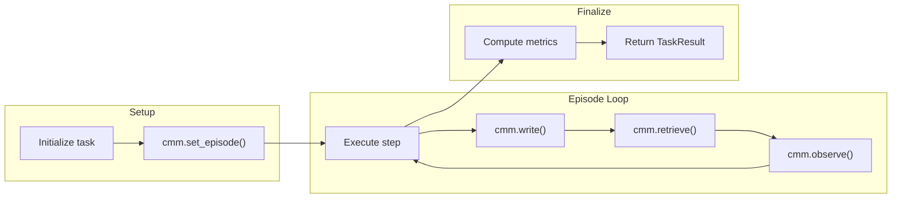
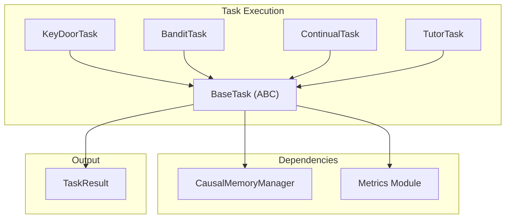

# Reckon Tasks Module

Choose a task to study a particular memory challenge, or implement `BaseTask` to add your own. Each runner receives a memory manager and returns its task-specific results. When testing a retention policy, keep the task settings and seeds matched so you can interpret a difference.

<a id="purpose"></a>

## Task Descriptions

### Task A: Key-Door Navigation

A grid-navigation task with an early colored-key cue and a later door choice. A wall forces the controller through one of two doors. It reads that episode's cue once, goes right for blue and left otherwise; green does not identify which door opens. An absent cue therefore uses the same fixed left guess. Each query attempt counts as a read, including an empty result. Records can carry across episodes, but each choice asks for the current episode's key. One slot holds that cue through its decision, so this workload checks memory use without necessarily distinguishing retention rankings. The [task manual](../../../docs/09-Tasks-Benchmarks.md) explains the controller and the exploratory comparison's limits.

| Property | Value |
| --- | --- |
| **Challenge** | Retain and retrieve a cue within an episode |
| **Memory Need** | Cue-outcome associations |
| **Success Metric** | Episodes reaching the goal / episodes; `mean_return` uses the same binary reward |
| **Reference** | [docs/09-Tasks-Benchmarks.md](../../../docs/09-Tasks-Benchmarks.md) |

### Task B: Multi-Armed Bandit

A bandit task whose optimal arm depends on a changing hidden mode, with occasional mode indicators. The runner re-reads the retained indicator before choosing an arm. It still prunes stale indicators at tracked switches and when a newer one arrives; each episode reports these task-directed prunes separately from the retention policy. The seed creates separate environment and action streams, so missing memory can increase random exploration without changing modes, indicator arrivals or reward noise in the paired run.

| Property | Value |
| --- | --- |
| **Challenge** | Track mode changes and use the available indicators |
| **Memory Need** | Retained mode indicators used at each arm choice |
| **Success Metric** | `mean_regret` per step and `mean_return` per episode; detection lag is in `raw_data` |
| **Reference** | [docs/09-Tasks-Benchmarks.md](../../../docs/09-Tasks-Benchmarks.md) |

### Task C: Continual Learning

A sequence of classification subtasks with rotating decision boundaries. The runner trains a linear classifier, writes misclassified examples and retrieves retained examples for replay.

| Property | Value |
| --- | --- |
| **Challenge** | Catastrophic forgetting |
| **Memory Need** | Examples retained for replay across subtasks within an episode |
| **Success Metric** | Final accuracy averaged over subtasks, and the positive drop from earlier post-training accuracy to final accuracy |
| **Reference** | [docs/09-Tasks-Benchmarks.md](../../../docs/09-Tasks-Benchmarks.md) |

### Task D: Interactive Tutoring

A structured simulation of student misconceptions, questions and hints across sessions. It records which hints succeeded for each concept; it is not a dialogue-model evaluation. Each episode has an independently seeded starting student, concept choices and hint choices. Response randomness is assigned to the question index, so skipped hints cannot shift a later question’s draw. Student state and the eligible concepts may still diverge because the hints have different effects.

| Property | Value |
| --- | --- |
| **Challenge** | Reuse concept/hint associations across simulated sessions |
| **Memory Need** | Records of effective hints; the environment maintains its own student state |
| **Success Metric** | Fraction of initial misconceptions cleared, averaged over episodes; an episode with none initially uses one |
| **Reference** | [docs/09-Tasks-Benchmarks.md](../../../docs/09-Tasks-Benchmarks.md) |

## BaseTask Interface

All tasks inherit from `BaseTask` and implement:

| Method/Property | Purpose |
| --- | --- |
| `name` | Human-readable task identifier |
| `description` | Brief explanation of the task |
| `run(cmm, num_episodes, seed, *, reset_memory=False, learn_utility=True)` | Execute task and return `TaskResult` |

## Execution Flow

This schematic shows possible memory operations. Each task owns its schedule; not every step writes, reads and updates a score. By default the four runners carry records, scores and retained events across episodes. `reset_memory=True` selects empty memory at each boundary. Each episode has an `EpisodeContext`; retrieval is tracked and the outcome reaches `observe()`, unless `learn_utility=False` selects the fixed-score comparison. Both settings appear in `raw_data`. Task and environment state have their own lifetimes.



## Integration

### Outcome credit

Key-Door reports its final binary reward; Continual reports final mean accuracy; Tutor reports the fraction of misconceptions cleared. Each divides that episode’s supplied outcome among records retrieved in its context. Bandit clears retrieval credit at each arm choice and reports the resulting reward immediately. These are learned utility signals, not measured record-ablation effects. Continual and Tutor label their hand-supplied initial importance in record metadata instead of assigning it as learned utility; Tutor no longer increments utility by a hand-set half point. The importance-only comparison can use that separate input.

### With CLI

Tasks are invoked via CLI:

```
reckon run --task keydoor --episodes 100 --budget-slots 50
```

The `TASKS` registry in [`cli.py`](../cli.py) maps CLI names to task classes. [`tasks/__init__.py`](__init__.py) exports the classes. One CLI invocation runs the selected task; it does not arrange all baseline arms or run record probes.

### With Metrics

The four runners construct `PerformanceMetrics`, `MemoryEfficiencyMetrics` and a `diagnostics` dictionary with task-specific names. They do not automatically call the memory or usage/oracle helpers or invoke contract evaluation. Key-Door reports `successful_stored_key_episode_fraction`; Continual reports `one_minus_mean_forgetting`; Tutor distinguishes mean episode and pooled effective-hint read fractions. The exact producers and denominators are in [Tasks and Benchmarks](../../../docs/09-Tasks-Benchmarks.md). Historical runs keep their original keys and source identity.

Keep raw episode data and the producer with each value. A usage association, oracle label and measured intervention contrast establish different things; the [metrics guide](../metrics/README.md) explains the helper and evaluator paths.

<a id="task-design-principles"></a>

## Add a task

Implement `name`, `description` and `run(cmm, num_episodes, seed, *, reset_memory=False, learn_utility=True)`. Use the supplied seed to initialize the task's random state. Set the logical step before memory operations, and choose carry or reset explicitly when calling `set_episode()`. Retained events share the native finite buffer; drain them before they are overwritten.

Keep state outside the manager explicit: a classifier, local belief or environment history can retain information even after CMM pruning. Report the outcome and denominator your runner actually computes. Supply necessary-cue labels only where the task provides them, and use a separate intervention experiment to test a record's contribution.

:::accordion "Source map and dependencies"

## Architecture



## Module Structure

Implement the `BaseTask` interface when adding a runner. For a concrete example, trace the cue handling in `task_a_keydoor.py` or the replay loop in `task_c_continual.py`.

:::

<a id="maintenance-gotchas"></a>

## Troubleshooting

1. **Random Seeds**: Always use the provided `seed` parameter for reproducibility. Initialize RNG at task start.

2. **Episode Reset**: The task’s `reset_memory` option controls CMM state independently of task or environment resets. Carried records keep their original episode identity, while new events use the current episode.

3. **Testing necessity**: A record may appear in a successful run without affecting its outcome. Keep counts and labels separate from tests that change the record.

4. **Step Synchronization**: Call `cmm.set_step()` before each memory operation for correct timestamps.

5. **Metric Computation Order**: The current runners construct metrics from their own counters. An optional `MemoryEfficiencyMetrics.from_cmm()` call drains the event log; preserve required events before that consumption and inspect the [helper's expected event shape](../metrics/README.md#memoryefficiencymetrics).

<a id="further-reading"></a>

## Related guides

- [Parent: Main Module](../README.md)
- [Tasks and Benchmarks Spec](../../../docs/09-Tasks-Benchmarks.md)
- [Metrics Module](../metrics/README.md)
- [Memory Module](../memory/README.md)
