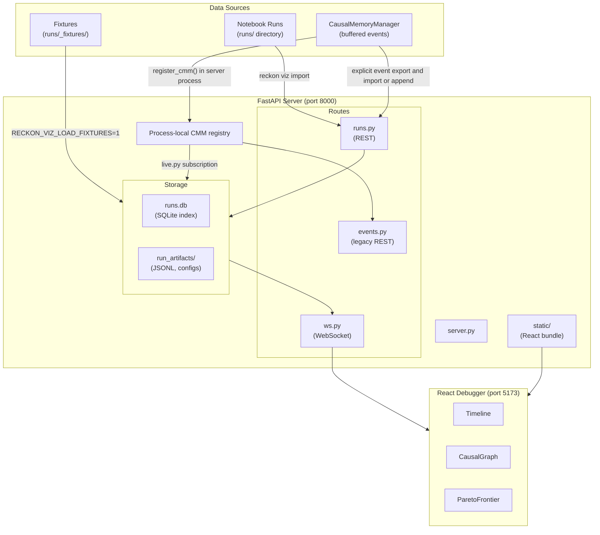

# Reckon Viz Module

The FastAPI backend imports saved runs, indexes their metadata and delivers their events to the browser over REST and WebSocket. It can also serve a React interface when that interface has been separately built and copied into the static directory. Importing a run copies its recorded data; it does not rerun the task or create missing observations.

Use this page to call an endpoint, embed run storage or build the interface bundle. For the ordinary startup/import procedure, follow [Inspect an exported run](https://causality.in/reckon/inspect-an-exported-run/).

## Architecture



## Module Structure

Change `projection.py` for the shared kernel-to-viewer conversion, `live.py` for manager subscriptions, `server.py` for app setup or static assets, `storage.py` for the SQLite index and run files, and `routes/runs.py` or `routes/ws.py` for the HTTP and WebSocket interfaces.

<a id="quick-start"></a>

## Get started

Follow [Inspect an exported run](https://causality.in/reckon/inspect-an-exported-run/) to start both servers, import a saved event log and read the views. A metrics table or figure alone cannot supply events.

Complete [installation](../../../docs/01a-Installation.md), including the extension import check, before working on the backend. The sections below cover its API, storage, embedding and interface build. The server imports recorded observations; it does not rerun tasks or probes.

## REST API

### Runs Management (`routes/runs.py`)

| Endpoint               | Method | Purpose                              |
| ---------------------- | ------ | ------------------------------------ |
| `/v1/runs`             | GET    | List all runs with summaries         |
| `/v1/runs/{id}`        | GET    | Get run details                      |
| `/v1/runs/{id}/events` | GET    | Read a page of stored events         |
| `/v1/runs/{id}/events` | POST   | Append events and notify subscribers |
| `/v1/runs/import`      | POST   | Import run from JSON body            |
| `/v1/runs/import-path` | POST   | Import run from filesystem path      |

| Read | Filters | Pagination |
| --- | --- | --- |
| `GET /v1/runs` | `task_name`, `config_id` | `limit` defaults to 50 and accepts 1–100. `offset` defaults to 0. |
| `GET /v1/runs/{id}/events` | `episode_id`, `event_type` | `limit` defaults to 1,000 and accepts 1–10,000. `offset` defaults to 0. |

Imports validate every nonempty JSONL line before writing. The accepted event formats are native Rust operation records, the bundled legacy named-event export and the camelCase debugger format described in the [data contract](../../../docs/10-Debugger-Visualization.md). Unknown root fields, malformed operations and conflicting content under one event ID are refused. Identical repeats are skipped by event identity; distinct events at tied steps remain distinct. HTTP imports refuse an existing run ID. There is no HTTP deletion endpoint; explicit local CLI deletion remains available.

### WebSocket (`routes/ws.py`)

Real-time event streaming:

| Message Type | Direction | Purpose |
| --- | --- | --- |
| `subscribe` | Client→Server | Subscribe to run: `{"type": "subscribe", "run_id": "..."}` |
| `snapshot` | Server→Client | Initial events: `{"type": "snapshot", "run_id": "...", "events": [...]}` |
| `events` | Server→Client | New events batch |
| `ping/pong` | Both | Keepalive |

**Connection URL:** `ws://localhost:8000/v1/stream?run_id=<run_id>`

The server serializes snapshot subscription and appends within each run. A slow connection is closed after a ten-second send timeout; reconnecting obtains the persisted snapshot. Messages are not silently dropped. Run one server process per data directory: these locks do not coordinate separate workers or CLI imports.

## Storage (`storage.py`)

### RunIndex and RunStore

`RunIndex` stores and queries metadata in SQLite. `RunStore` reads and writes event bytes and optional summary files; it does not import a directory or list indexed metadata. The CLI coordinates those two owners when importing a run.

The store accepts a run directory only when its resolved parent is the store root, and an artifact only when its resolved parent is that run directory. Invalid run names, traversal and symlinks resolving outside those locations are refused. These path checks keep run files inside their selected store; they do not authenticate a caller.

Success rate is nullable in the index, HTTP responses and run snapshots. An observed zero remains a measurement and displays `0% success`; a missing measurement displays `Success unavailable`. Live memory operations do not imply a task success rate. Snapshot `summary` retains the supplied source fields, while the separate `success_rate` field carries the index’s measurement presence.

Opening an older derived index upgrades its measurement handling once. The earlier default stored missing success as zero: a zero explicitly recorded in its retained summary stays zero, positive stored measurements stay measured, and an ambiguous old zero becomes unavailable. New explicit zeroes remain measured when the index reopens. This updates the index only; original summaries and saved run files are unchanged.

From the repository root with the project environment active, this integration example copies the [example export](../../../runs/_fixtures/golden_run_export.json) into a new local data directory:

```python
import json
from pathlib import Path
from reckon.viz.projection import parse_events_jsonl
from reckon.viz.storage import create_storage, parse_run_export

data = Path("storage-example-data")
data.mkdir()  # Choose a new directory; do not replace an earlier example.
index, store = create_storage(data)

export = json.loads(Path("runs/_fixtures/golden_run_export.json").read_text())
meta, events_bytes = parse_run_export(export)
parse_events_jsonl(events_bytes)  # Refuse data the viewer cannot interpret.
store.store_events(meta.run_id, events_bytes)
if meta.summary_json:
    store.store_summary(meta.run_id, meta.summary_json)
index.add_run(meta)

runs = index.list_runs(limit=10, task_name=meta.task_name)
assert any(run.run_id == meta.run_id for run in runs)

# The store returns the complete JSONL bytes, not a paginated event list.
events = store.get_events(meta.run_id)
assert events == events_bytes
```

The directory now contains `runs.db` and `run_artifacts/<run_id>/events.jsonl`, plus `summary.json` for the supplied summary. This copies the example's metadata and events without running its task. Replace the export path with your own file when embedding storage. To inspect a run through the application, use the import command in the [product guide](#get-started).

`RunIndex.list_runs` accepts `limit`, `offset`, `config_id` and `task_name`. `RunStore.get_events` returns all stored bytes for one run; the REST event endpoint owns event pagination. Neither operation reconstructs missing configuration, figures or event history from a summary.

## CLI Commands (`cli.py`)

Set `RECKON_VIZ_DATA_DIR` to a directory you can write to. Use the same value for the import, server and listing commands so they use the same run index.

```bash
export RECKON_VIZ_DATA_DIR="$PWD/reckon-debugger-data"

# Import a run directory
reckon viz import "<run_path>"

# Import with custom run ID
reckon viz import "<run_path>" --run-id my_custom_id

# Start the server
reckon viz serve --port 8000

# List imported runs
reckon viz list
```

## Integration

### With Notebooks

Notebook artifacts default to `notebooks/runs/` relative to the repository root. Use an actual exported event-log run with the [quick start](#get-started); the [notebook guide](../../../notebooks/README.md) owns modes and optional dependencies.

### With CausalMemoryManager (Process-Local Registration)

`register_cmm()` exposes one manager to a server running in the same Python process. During its lifespan, the server subscribes to that manager, copies its retained kernel log, persists subsequent operations and broadcasts them through the v1 run stream. Each logger generation gets a `live-<source-id>` run; resetting memory starts a new source even though its event IDs restart at zero.

```python
from reckon import CausalMemoryManager, MemoryBudget
from reckon.viz import register_cmm
from reckon.viz.server import create_app

cmm = CausalMemoryManager(MemoryBudget(max_slots=1000))
register_cmm(cmm)
app = create_app()  # Serve this app in this process while the task uses cmm.
```

Registration alone does not start the server. Starting `reckon viz serve` in another terminal creates a different process and registry. For that arrangement, save and import the log or append operations through the REST API. Refresh the run selector when a new live source appears.

The subscription copies each operation under the manager lock, before a caller can drain its log. It refuses attachment after known ring overflow and reports that error in `/health` as `live_error`. Events drained before attachment are unavailable to the subscription. Start the server before the task for a complete capture. Graceful server shutdown detaches the subscription and flushes its remaining queue; abrupt process loss is not a durability guarantee. The diagnostic queue is outside the task's memory budget and grows if production outruns persistence. This is a trusted local laboratory interface, without user authentication or a cross-process manager protocol.

### With viz-ui

Build and deploy the React application:

```bash
# From the repository root, build without changing the calling terminal's directory
(cd viz-ui && pnpm install && pnpm build)

# Copy to static (for bundled deployment)
mkdir -p src/reckon/viz/static
cp -r viz-ui/packages/debugger/dist/* src/reckon/viz/static/
```

For development, follow the separate backend and interface terminals in the [quick start](#get-started); the interface proxies to the backend on port 8000.

## Fixture Loading

To try the server with the example export after installing a wheel, import the file from the repository root:

```bash
reckon viz import runs/_fixtures/golden_run_export.json
```

When Python loads the server directly from the checkout, you can set `RECKON_VIZ_LOAD_FIXTURES=1` on `python -m reckon.viz.server`. This looks for `runs/_fixtures/` relative to the loaded module, so use the explicit import if you installed a wheel.

<a id="maintenance-gotchas"></a>

## Troubleshooting

1. **Two Servers**: Development requires both Python (8000) and Vite (5173) servers running.

2. **Storage Location**: The default is `$XDG_DATA_HOME/reckon/viz`, or `~/.local/share/reckon/viz` when unset. Existing source-tree data is left in place; select its directory explicitly or import its run files into the new store. Use `RECKON_VIZ_DATA_DIR` for CLI and server commands. For an embedded store, pass a `base_path` to `RunStore`.

3. **CORS**: Enabled for development (allows localhost:5173). Restrict in production.

4. **WebSocket State**: Connections track subscribed run_id. Re-subscribe after reconnection.

5. **SQLite Locking**: Single-writer model. Don't run multiple import commands simultaneously.

6. **Fixture Schema**: Fixtures must match `MemoryRecord` interface (payloadType, provenance.inputIds, etc.).

<a id="further-reading"></a>

## Related guides

- [Parent: Main Module](../README.md)
- [Debugger Visualization Spec](../../../docs/10-Debugger-Visualization.md)
- [TypeScript Debugger](../../../viz-ui/README.md)
- [Memory Module](../memory/README.md)
