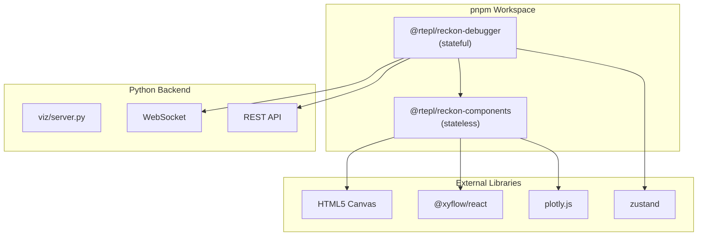
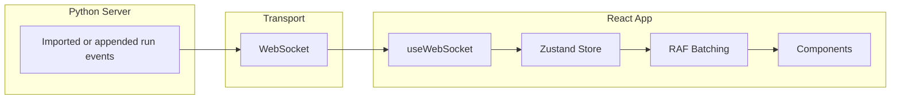

# Reckon Visualization UI

Build the browser interface here when changing the debugger or embedding one of its views. The workspace separates reusable view components from the application that selects runs, maintains state and receives events. The Python backend is a separate process; the [server guide](../src/reckon/viz/README.md) explains its import and streaming interfaces.

For ordinary inspection of a saved run, follow [Inspect an exported run](https://causality.in/reckon/inspect-an-exported-run/). The build and package boundaries below are for interface development.

## Architecture



## Directory Structure

Run build commands from `viz-ui/`, where `package.json` defines the workspace scripts. Change the [components](packages/components/README.md) for a reusable view or the [debugger application](packages/debugger/README.md) to change how it receives and displays a run.

## Packages

### `@rtepl/reckon-components`

Stateless, reusable visualization components:

| Component | Library | Purpose |
| --- | --- | --- |
| Timeline | Custom Canvas | Memory event timeline; 100K+ events is a design target |
| CausalGraph | @xyflow/react | Directed graph of record dependencies and supplied evidence |
| ParetoFrontier | plotly.js | Named cost/outcome comparison or operation-count proxies |
| ViolationsPanel | React | Transitivity violation display and filtering |
| ComputeLedger | React | HUD showing base/probe episodes, overhead |
| EdgeDrawer | React | Side drawer with edge details (measured/inferred/proxy) |
| EdgeDisplayControl | React | Choose visible edge evidence and show a supplied probe queue |
| TruthModeSwitch | React | Switch between RESEARCH/PRODUCT modes |
| EdgeLegend | React | Legend for edge visual encoding |

See: [packages/components/README.md](packages/components/README.md)

### `@rtepl/reckon-debugger`

Stateful debugger application:

| Feature         | Purpose                                      |
| --------------- | -------------------------------------------- |
| Store (Zustand) | Global state management                      |
| WebSocket Hook  | Real-time event streaming                    |
| Feature Modules | Timeline, CausalGraph, ParetoFrontier panels |

See: [packages/debugger/README.md](packages/debugger/README.md)

## Data Flow



### RAF Batching

The WebSocket hook batches foreground updates with `requestAnimationFrame`:

1. Events arrive via WebSocket
2. Accumulated in pending buffer
3. RAF callback flushes to store
4. Components update on the available browser animation frame.

At 1,000 pending events the hook flushes the batch immediately. A hidden-document branch forwards events directly to the store. This reduces update frequency without dropping queued events; it does not guarantee a frame rate. The [application guide](packages/debugger/README.md#maintenance-gotchas) describes the store’s separate limits.

The server converts native kernel operations once for imports, REST reads, snapshots and live messages. A manager registered in the server process supplies a live subscription; other processes export or append events. The browser consumes that shared format without another raw-event conversion. [Server integration](../src/reckon/viz/README.md#with-causalmemorymanager-process-local-registration) distinguishes this from process-local CMM registration.

## Building

### Development

From the Reckon root, install workspace dependencies, build the shared components and start Vite. The debugger imports the components package from `dist/index.js`, so a fresh checkout needs that build before the application can start.

```bash
cd viz-ui
pnpm install
pnpm build:components
pnpm dev
```

### Production

```bash
cd viz-ui
pnpm build
```

Output goes to `packages/debugger/dist/`.

### Deploy to Python Package

```bash
cp -r packages/debugger/dist/* ../src/reckon/viz/static/
```

## Check the graph’s evidence rules

Install the test browser once, then run the component tests and the synthetic pair-evidence browser test:

```bash
pnpm exec playwright-core install chromium
pnpm test
```

The browser test starts its own loopback server and loads the current component source. It checks graph, drawer and legend agreement across edge display and product modes, mismatched probe pairs, missing endpoints, duplicate edges and explicit probe unavailability. It separately exercises the reusable control's optional probe callback, cost confirmation and cancellation. The fixture supplies evidence directly to the application store; it does not establish backend probe execution, admission or performance at scale. A separate frontier browser fixture checks raw return values, explicit accuracy percentages, uncertainty scaling, current-run markers and the event-count proxy axes. These inputs are illustrative. `RECKON_CHROMIUM` can select an existing Chromium executable for either browser test; the result reports its actual version. Use `pnpm test:components`, `pnpm test:evidence` or `pnpm test:frontier` to run a part separately.

## Check a real manager in the browser

After the Python `dev,viz` environment and Rust extension are installed, build the interface and install the test browser:

```bash
pnpm build
pnpm exec playwright-core install chromium
pnpm test:browser
```

The test starts its own loopback servers, produces a real manager run, imports a second copy and inspects every operation in both runs. It uses temporary test storage under the repository's excluded `experiments/runs/` directory and removes that storage on exit. Set `RECKON_PYTHON` if the environment is not at `../.venv/bin/python`. This checks transport and inspection for a small actual run; the 100,000-event performance target needs a separate benchmark.

## Check native record conversion

`pnpm test:record-wire` sends actual manager records through native storage, explicit byte encoding and the Rust-derived JSON/TypeScript model to the inspector. It also checks the historical Python/native/protobuf-ts wire round trip. Opaque bytes, ordered duplicate tags, supplied or absent origin, optional zero values and signed measurements survive. Unknown token counts display “Not recorded”; a declared zero displays zero. The adapters refuse int64 values outside the viewer's exact integer range while the exchange formats retain their decimal strings. Set `RECKON_PYTHON` for the rebuilt Python environment and `RECKON_CHROMIUM` for an existing browser. The Python environment needs the `dev,rpc` extras.

This is a small conversion fixture, separate from the live server test above. It does not change how existing run imports or WebSocket events arrive or exercise the daemon's different typed-tag record. Component builds generate record descriptions from `kernel/src/record.rs`; `pnpm generate:records` runs that step separately and requires the Rust toolchain. Generated descriptions stay outside Git.

## TypeScript Configuration

### Base Config

`tsconfig.base.json` provides shared settings:

- ES2022 target
- Strict mode
- Path aliases

### Package Configs

Each package extends the base and adds local paths.

## Proto Integration

TypeScript types are generated from Protocol Buffers:

```bash
pnpm proto:gen
```

Run from `viz-ui/`; the script enters the repository’s `protos/` directory. Output: modules under `viz-ui/generated/reckon/`. The `reckon.ts` and `index.ts` entry files re-export those modules; they contain no duplicate type definitions.

<a id="maintenance-gotchas"></a>

## Troubleshooting

1. **pnpm Workspace**: Use `pnpm` commands from `viz-ui/` root. Individual package commands may miss workspace dependencies.

2. **Path Aliases**: The `@/` alias resolves differently per package. Check each package's `tsconfig.json`.

3. **Canvas Performance**: Timeline uses raw Canvas API for performance. Avoid React state for frequently updated visual elements.

4. **React Flow Layout**: CausalGraph uses manual positioning. Automatic layout (dagre) can be added but impacts performance.

5. **Plotly Bundle Size**: plotly.js-dist-min is used to reduce bundle size. Full features require the complete package.

6. **WebSocket Reconnection**: The hook implements exponential backoff. Test reconnection behavior after server restarts.

<a id="further-reading"></a>

## Related guides

- [Components Package](packages/components/README.md)
- [Debugger Package](packages/debugger/README.md)
- [Python Server](../src/reckon/viz/README.md)
- [Debugger Visualization Spec](../docs/10-Debugger-Visualization.md)
