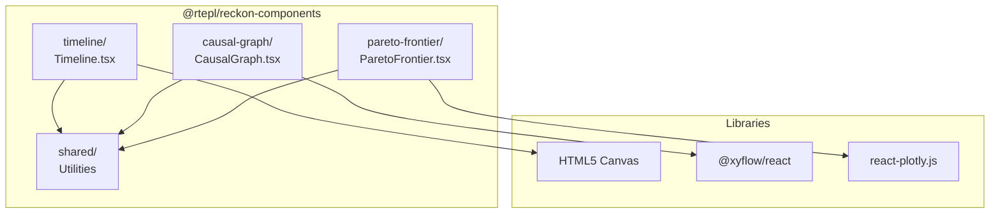

# Reckon Visualization Components

Embed these React components when an application needs a memory timeline, relationship graph or cost/outcome plot. Supply their events, measurements and selection callbacks through props. Components may keep local display state, but they do not manage the debugger's global run store, collect experiment results or execute intervention probes.

The [cost/outcome example](#with-custom-applications) supplies a complete small plot. Read each component's input contract before reusing it; an operation log alone does not contain the full records or measured outcomes required by every view.

## Architecture



## Directory Structure

Find public exports in `src/index.ts` and input types in `src/types.ts`. The component sections below show which props to pass to each view.

## Components

### Timeline

High-performance timeline visualization using HTML5 Canvas.

| Feature               | Implementation                    |
| --------------------- | --------------------------------- |
| Virtualized rendering | Only draws visible events         |
| Zoom/pan              | Mouse wheel + drag                |
| Hit testing           | Spatial index for click detection |
| Lane-based grouping   | Multiple event tracks             |

**Key Props:**

| Prop                | Type               | Purpose             |
| ------------------- | ------------------ | ------------------- |
| `events`            | `DebuggerEvent[]`  | Events to display   |
| `timeRange`         | `[number, number]` | Visible time window |
| `onEventClick`      | `(event) => void`  | Click handler       |
| `onTimeRangeChange` | `(range) => void`  | Zoom/pan callback   |
| `lanes`             | `TimelineLane[]`   | Lane configuration  |

**Performance:**

- Draws only visible events
- Schedules pan/zoom drawing with RAF
- 100K+ events is a design target; actual frame rate depends on the data, viewport and host

### CausalGraph

React Flow draws links from record inputs and any edges you supply. It can display cycles. If you see one, check where the edges came from before interpreting it as causal feedback.

| Feature | Implementation |
| --- | --- |
| Node layout | Positions derived from event records; the current `layout` selector is not implemented |
| Edge rendering | React Flow edges |
| Selection | Node/edge highlighting |
| Pan/zoom | React Flow controls |

**Key Props:**

| Prop | Type | Purpose |
| --- | --- | --- |
| `events` | `DebuggerEvent[]` | Required events from which record nodes and provenance edges are derived |
| `additionalEdges` | `CausalEdge[]` | Optional externally supplied candidate edges |
| `onNodeClick` | `(record: MemoryRecord) => void` | Record selection callback |
| `selectedRecordId` | `string \| null` | Optional highlighted record identity |

### ParetoFrontier

Scatter plot of cost versus a supplied outcome using Plotly. An embedding can pass measured `points`; the current application instead uses its event-derived default, whose default y axis is explicitly labelled as an operation-count proxy. The [frontier data contract](../../../docs/10-Debugger-Visualization.md#c-budget-vs-performance-frontier) distinguishes these paths.

| Feature         | Implementation       |
| --------------- | -------------------- |
| Scatter plot    | Plotly scatter trace |
| Frontier line   | Computed from data   |
| Tooltips        | Plotly hover         |
| Click selection | Plotly click events  |

**Key Props:**

| Prop | Type | Purpose |
| --- | --- | --- |
| `events` | `DebuggerEvent[]` | Required event input; use an empty array when supplying precomputed points |
| `points` | `ParetoPoint[]` | Optional precomputed points, each with finite `x`/`y` and matching `xMetric`/`yMetric` names |
| `axes` | `FrontierAxes` | Required with supplied points; each axis names its metric, optional label and `number` or `percent` format |
| `xLabel` | `string` | X-axis label (e.g., "Memory Bytes") |
| `yLabel` | `string` | Y-axis label (e.g., "Success Rate") |
| `onPointClick` | `(point) => void` | Selection handler |

When supplying precomputed points, name each measurement in both the points and `axes`. Missing or inconsistent names are refused, including extra current-run or selected markers. Labels describe the chosen quantities; they do not select data or units. Supplied axes use raw numbers unless explicitly set to `format: "percent"`, which multiplies coordinates and standard deviations by 100. A mean return of 7.5 therefore remains 7.5; it does not silently become 750%. Lower x and higher y are considered better; a loss or latency metric needs the appropriate transformation before using that convention.

A point is dominated when another has no higher cost and no lower outcome, with at least one strict improvement. Equal-cost points are compared together, so `(2, 0.60)` is dominated by `(2, 0.80)` in either input order. Exact duplicate coordinates remain separate candidates and do not dominate each other; another point can dominate both. The component does not choose between their configurations. Inputs are copied before marking frontier membership. Missing or non-finite supplied coordinates are refused.

Event extraction offers `byteBudgetFraction`, `byteCount`, `tokenCount` and `slotCount` on x, and `writeShare`, `netWritesPerWrite` and `writeCount` on y. The defaults are final bytes divided by the byte allowance and writes divided by writes plus prunes. Net writes per write is `(writes - prunes) / writes`. Both y ratios are labelled as operation proxies and displayed as percentages; they do not measure task success. Missing counts or denominators do not become zeros. Counts do not require a budget when no ratio is requested. Budget ratios above one and negative net-write ratios retain their values and expand the plot range. Other measurements, including task outcomes and probe costs, require supplied points with their own axes. The old `performance`/`retention` selectors and `budget`/`performance` coordinate aliases are removed.

### ViolationsPanel

Panel for displaying supplied transitivity diagnostics (A->B and B->C detected, with A->C unconfirmed). The debugger mounts it beside the graph, but no application producer supplies its report. A null report displays an unavailable message; a supplied report with zero violations displays that count and the number of triples checked. These are different states.

| Feature | Implementation |
| --- | --- |
| Violation list | Scrollable cards |
| Filters | measuredOnly, insufficientNOnly, borderlineOnly, untestedOnly |
| Edge status | Visual indicators for tested/untested edges |
| Actions | onVerifyEdge, onIncreaseN callbacks |

**Key Props:**

| Prop | Type | Purpose |
| --- | --- | --- |
| `report` | `TransitivityReport \| null` | Violations to display |
| `onViolationSelect` | `(v) => void` | Selection handler |
| `onVerifyEdge` | `(src, tgt) => void` | Trigger edge verification |

### ComputeLedger

A compute-accounting panel for caller-supplied task and probe costs. The debugger mounts its compact form below the graph, but no application producer supplies the ledger. A null ledger displays an unavailable message, not zero cost. An embedding must supply its own accounting measurements; memory events alone do not provide them.

| Feature        | Implementation                              |
| -------------- | ------------------------------------------- |
| Episode split  | Base vs probe bar chart                     |
| Overhead ratio | Probe overhead percentage with color coding |
| Efficiency     | Reward per episode/second metrics           |
| Pending        | Cost to verify unverified edges             |

**Key Props:**

| Prop | Type | Purpose |
| --- | --- | --- |
| `ledger` | `ComputeLedgerData \| null` | Compute metrics |
| `compact` | `boolean` | HUD vs full panel mode |
| `onVerifyPending` | `() => void` | Trigger pending verifications |

### EdgeDrawer

Side drawer showing detailed information about a causal edge.

| Feature              | Implementation                       |
| -------------------- | ------------------------------------ |
| Status badge         | Measured/Inferred/Proxy type         |
| Probe evidence       | p-value, q-value, effect size, n, CI |
| Confidence sparkline | Historical q-values                  |
| Actions              | Rerun probe, verify edge             |

**Key Props:**

| Prop           | Type                | Purpose                |
| -------------- | ------------------- | ---------------------- |
| `edge`         | `EdgeStatus`        | Edge to display        |
| `isOpen`       | `boolean`           | Drawer visibility      |
| `onRerunProbe` | `(edge, n) => void` | Rerun with sample size |
| `onVerifyEdge` | `(edge) => void`    | Verify inferred edge   |

Probe and verification callbacks notify the consuming application. These components do not execute a record probe or turn a supplied edge label into independent evidence.

### EdgeDisplayControl

Choose which supplied edges appear and inspect an optional pending-probe queue.

| Mode | Description |
| --- | --- |
| MEASURED_ONLY | Show pairs with direct probe evidence (debugger default) |
| INCLUDE_UNMEASURED | Also allow supplied inferences and enabled provenance proxies |
| PROBE_STATUS | Show measured pairs and any caller-supplied probe queue and cost |

The control emits a mode choice to its parent; the graph applies the corresponding evidence filter. It neither computes transitive closure nor verifies an edge. The Product view still hides inferred and proxy links regardless of the requested edge display mode. An embedding may supply `onVerifyAll` with counts and cost estimates; both unmeasured-edge and pending-queue actions ask for confirmation before invoking it. Cancellation makes no callback. The standalone debugger supplies no execution handler. Probe evidence requirements are described in the [debugger chapter](../../../docs/10-Debugger-Visualization.md#b-relationship-graph).

### TruthModeSwitch

Toggle between research and product modes.

| Mode     | Description                        |
| -------- | ---------------------------------- |
| RESEARCH | Requests the research presentation |
| PRODUCT  | Requests the product presentation  |

### EdgeLegend

Legend explaining edge visual encoding.

| Edge Type | Visual | Description |
| --- | --- | --- |
| Measured | Solid green | Supplied probe evidence matched to the edge ID, source and target; the pair was assessed, not necessarily supported |
| Inferred | Dashed orange | Supplied candidate reachability, pending direct evidence |
| Proxy | Dotted blue | Provenance link weighted by the target's influence proxy, or zero when absent |

A target record's attribution delta does not make its incoming links measured. The graph needs pair-bound probe evidence for that label; see the [graph evidence and filtering contract](../../../docs/10-Debugger-Visualization.md#b-relationship-graph).

## Shared Types

Defined in `src/types.ts`:

| Type                    | Purpose                                         |
| ----------------------- | ----------------------------------------------- |
| `TimeRange`             | `[start, end]` tuple                            |
| `TimelineLane`          | Lane configuration                              |
| `DebuggerEvent`         | Memory event data                               |
| `CausalNode`            | Graph node                                      |
| `CausalEdge`            | Graph edge                                      |
| `ParetoPoint`           | Frontier data point                             |
| `EdgeStatus`            | Full edge status with probe evidence            |
| `ProbeEvidence`         | Statistical evidence (p, q, effect size, n, CI) |
| `TransitivityViolation` | Violation triple (A->B, B->C, A->C fails)       |
| `TransitivityReport`    | Full validation report                          |
| `ComputeLedgerData`     | Compute accounting metrics                      |

### Edge Semantics

| Enum | Values | Purpose |
| --- | --- | --- |
| `EdgeType` | measured, inferred, proxy | Causal edge classification |
| `EdgeDisplayMode` | measured_only, include_unmeasured, probe_status | Supplied-edge display and queue view |
| `TruthMode` | research, product | Information display mode |
| `ConfidenceLevel` | weak, medium, strong | Edge confidence badge |
| `MultipleTestingMethod` | none, bonferroni, bh_fdr, holm | Statistical correction |

## Integration

### With Debugger App

The debugger imports components and passes store data:

```typescript
import {
  Timeline,
  CausalGraph,
  ParetoFrontier,
} from "@rtepl/reckon-components";
```

### With Custom Applications

For example, save this component as `BudgetComparison.tsx` in a browser-based React application with the components package linked. The three points are illustrative inputs, not laboratory measurements; replace them with results from your own fixed comparison.

```tsx
import { ParetoFrontier, type ParetoPoint } from "@rtepl/reckon-components";

const points: ParetoPoint[] = [
  { x: 2, y: 0.6, xMetric: "budget_slots", yMetric: "final_accuracy", isPareto: false, label: "2 slots" },
  { x: 8, y: 0.72, xMetric: "budget_slots", yMetric: "final_accuracy", isPareto: false, label: "8 slots" },
  { x: 16, y: 0.68, xMetric: "budget_slots", yMetric: "final_accuracy", isPareto: false, label: "16 slots" },
];

export function BudgetComparison() {
  return (
    <div style={{ height: 420 }}>
      <ParetoFrontier
        events={[]}
        points={points}
        axes={{
          x: { metric: "budget_slots", label: "Memory allowance (slots)" },
          y: { metric: "final_accuracy", label: "Final accuracy (%)", format: "percent" },
        }}
      />
    </div>
  );
}
```

The plot places 2 and 8 slots on the frontier. The 16-slot point costs more than the 8-slot point and has lower accuracy, so the plot marks it as dominated. To compare real experiments, report variation across repeated runs beside the plot. The component requires browser APIs; it is not a server-rendered chart.

<a id="maintenance-gotchas"></a>

## Troubleshooting

1. **Canvas DPI Scaling**: Timeline handles device pixel ratio for crisp rendering. Test on high-DPI displays.

2. **React Flow Version**: Using `@xyflow/react` (v12+). Earlier versions had different import paths.

3. **React Flow CSS**: The CausalGraph component requires React Flow styles. Import at app entry point:

   ```typescript
   import "@xyflow/react/dist/style.css";
   ```

   The component imports this internally, but bundlers may externalize it. Always import in the consuming app.

4. **Plotly Type Definitions**: Types from `@types/react-plotly.js` may lag behind library. Check compatibility.

5. **Event Coordinate Systems**: Timeline uses millisecond timestamps. Ensure consistent units from backend.

6. **Memory Cleanup**: Canvas component cleans up RAF on unmount. Verify no memory leaks in long sessions.

7. **SSR Incompatibility**: Canvas and Plotly require browser APIs. Not compatible with server-side rendering.

<a id="further-reading"></a>

## Related guides

- [Parent: viz-ui](../../README.md)
- [Debugger Package](../debugger/README.md)
- [Debugger Visualization Spec](../../../docs/10-Debugger-Visualization.md)
