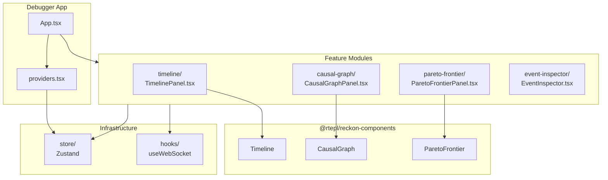
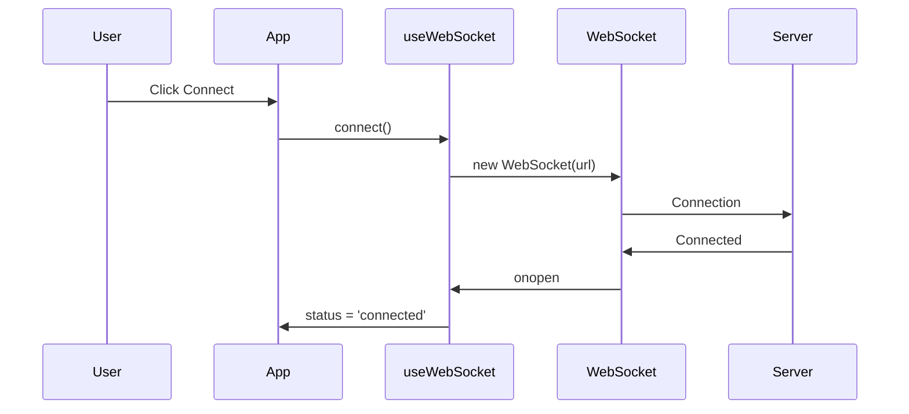
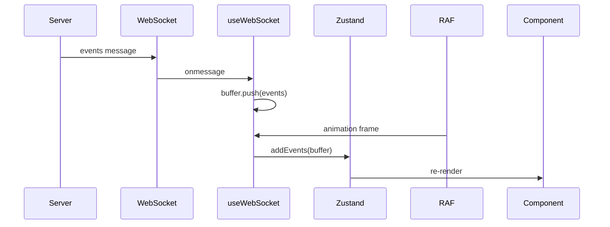

# Reckon Debugger Application

The application turns imported run events into three coordinated views: a timeline, a relationship graph and a cost/outcome plot. Its Zustand store owns the selected run, events, records and interface state. Feature panels adapt that state to the reusable components; the WebSocket hook connects it to the Python server.

The **Relationship graph** tab shows record links. The inspector labels each record’s supplied attribution source, displays its ablation and counterfactual deltas and **Influence (proxy)**, and counts proxy-only records in the selected snapshot. The [data contract](../../../docs/10-Debugger-Visualization.md#b-relationship-graph) defines missing-data states and field-presence rules; these values do not establish a measured relationship between two records.

Use this guide to change a panel or diagnose a connection/state problem. Check [the debugger data contract](../../../docs/10-Debugger-Visualization.md) first when a view lacks records or measurements: successful transport does not supply data absent from the export.

## Architecture



## Directory Structure

For a new panel, start in `src/features/` and connect it in `App.tsx`. For a state or connection issue, use the store (`src/store/index.ts`) or the WebSocket hook (`src/hooks/useWebSocket.ts`).

## Components

### App.tsx

Main application shell:

- Header with view mode tabs
- Connection status indicator
- Main content area with view panels
- Sidebar with event inspector

### Features

Each feature wraps a component with store integration:

| Feature | Component | Purpose |
| --- | --- | --- |
| `TimelinePanel` | Timeline | Memory event chronology |
| `CausalGraphPanel` | CausalGraph | Directed record-dependency and evidence graph; cycles are not rejected |
| `ParetoFrontierPanel` | ParetoFrontier | Budget/performance tradeoffs |
| `EventInspector` | Custom | Selected event/record details |

### Zustand Store

Global state management:

| Slice | State | Actions |
| --- | --- | --- |
| Events | `events[]`, `selectedEventId` | `addEvents`, `selectEvent`, `clearEvents` |
| Connection | `connectionStatus`, `lastError`, `wsUrl` | `setConnectionStatus`, `setWsUrl` |
| UI | `viewMode`, `sidebarOpen` | `setViewMode`, `toggleSidebar` |

Selectors:

- `selectConnectionInfo`: Derived connection state
- `selectEventStats`: Event counts by type

### WebSocket Hook

The hook returns `connect`, `disconnect`, `send` and `subscribeToRun`. Connection state is read from the Zustand store, rather than returned by the hook:

| Store state | Type | Purpose |
| --- | --- | --- |
| `connectionStatus` | `'connecting' \| 'connected' \| 'disconnected' \| 'error'` | Connection state |
| `lastError` | `string \| null` | Last connection error |

| Action | Purpose |
| --- | --- |
| `connect()` | Establish WebSocket |
| `disconnect()` | Close connection |
| `send(data)` | Send a caller-supplied message on an open connection |
| `subscribeToRun(runId)` | Select an imported run stream |

Features:

- Automatic reconnection with exponential backoff
- RAF batching for high-frequency updates
- Run subscription

## Data Flow

### Connection Flow



### Event Flow



## View Modes

| Mode       | Component           | Description              |
| ---------- | ------------------- | ------------------------ |
| `timeline` | TimelinePanel       | Chronological event view |
| `causal`   | CausalGraphPanel    | Record dependency graph  |
| `pareto`   | ParetoFrontierPanel | Budget tradeoff analysis |

## Building

### Development

Start with the [workspace setup](../../README.md#development) to install dependencies and build the shared components. Once they are built, run this from the debugger package for Vite with hot reload.

```bash
pnpm dev
```

### Production

```bash
pnpm build
```

Output: `dist/`

From `viz-ui/`, `pnpm test:record-scores` exercises the actual inspector against the shared Python/TypeScript score cases. It uses Playwright’s installed Chromium by default; `PLAYWRIGHT_CHANNEL=chrome pnpm test:record-scores` uses an installed Chrome. The check covers proxy-only, measured zero and negative, unscored and missing-data cases without running an experiment.

## Styling

Uses Tailwind CSS v4 with CSS custom properties:

| Variable          | Purpose          |
| ----------------- | ---------------- |
| `--color-bg`      | Background       |
| `--color-text`    | Text             |
| `--color-primary` | Primary accent   |
| `--color-accent`  | Secondary accent |

## Troubleshooting {#maintenance-gotchas}

1. **Store Immutability**: Zustand requires immutable updates. Use spread operators or immer.

2. **RAF Batching Timing**: Foreground events wait for an available animation frame; 16ms is not a latency guarantee. The hook flushes a full 1,000-event batch immediately. The hidden-document branch sends events directly to the store.

3. **WebSocket Reconnection**: Exponential backoff may delay reconnection. Reset on manual connect.

4. **View Mode Sync**: The URL does not record the selected view. Select the view again when reopening the application.

5. **Large Event Sets**: The store defaults to 50,000 events and 50,000 records and evicts older entries at those limits. The timeline reports how many earlier events are omitted from its window. The server retains the full history, available through paginated reads; preserve the original export too.

6. **Sidebar State**: The sidebar stays open or closed when you change views. Use its toggle to change that state.

## Related guides {#further-reading}

- [Parent: viz-ui](../../README.md)
- [Components Package](../components/README.md)
- [Python Server](../../../src/reckon/viz/README.md)
- [Debugger Visualization Spec](../../../docs/10-Debugger-Visualization.md)
